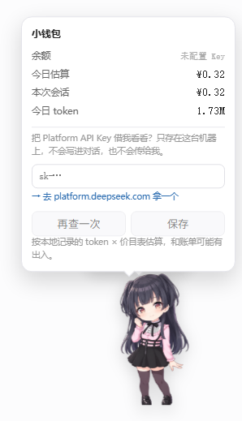

# dsh-pet-fuyuko

黛冬优子桌宠 —— DeepSeek Harness Web GUI 的客户端浮层插件。



> 当前状态：**M3（钱包）已完成** —— 她会报余额，也会算你花了多少。
> 报告：[M3-STATUS.md](M3-STATUS.md) · [M2-STATUS.md](M2-STATUS.md) · [M1-STATUS.md](M1-STATUS.md) · [M0-STATUS.md](M0-STATUS.md)
> 设计稿：[DESIGN.md](DESIGN.md) · 素材验收：[ASSET-REVIEW.md](ASSET-REVIEW.md)

## 它现在能做什么

- 在窗口右下角显示一张静态 Q 版冬优子（`shell.overlay` 帧级浮层）
- 可拖动，位置记在 `localStorage`，刷新后还在；窗口缩放自动夹回可视区
- **Alt + 滚轮缩放**（0.5×–2.5×），以脚底中心为锚点，缩放比例也会记住
- **跟着会话状态换表情**：模型思考时上浮、工具运行时摇摆、报错时抖动
- **会说话**：130 条台词，圆角气泡 + 小尾巴，跟随宿主亮暗主题
- **两种人格**：营业（温柔敬语）/ 本体（黑腹吐槽），菜单切换或单击时 10% 随机切
- **小钱包**：真实余额 + 本地花费估算（今日 / 本次会话），双击或右键打开
- **右键菜单**：说话 / 小钱包 / 换人格 / 静音 / 隐身 / 重置冷却
- **`Ctrl+Shift+F`** 隐身，再按一次唤回（只在当前窗口生效）
- 待机呼吸微动（CSS `transform`，不跑 rAF）；`prefers-reduced-motion` 自动关掉
- 窗口级常驻：落地页、设置页也在（桌宠属于窗口，不属于某个会话）
- 素材、台词、价目表改完刷新即生效（由 host 半边实时服务）

### 操作

| 操作 | 效果 |
|---|---|
| 拖动 | 移动，松手后记住位置 |
| **Alt + 滚轮** | 缩放立绘（上滚放大、下滚缩小），右下角短暂显示百分比 |
| 单击身体 | 说一句台词；10% 几率切换人格 |
| 单击呆毛 | 呆毛弹一下 + 傲娇台词 |
| **双击** | 打开小钱包（余额 + 今日花费 + 今日 token） |
| 悬停 | `curious`（探头） |
| **右键** | 菜单：说话 / 小钱包 / 换人格 / 静音 / 隐身 / 重置冷却 |
| **Ctrl+Shift+F** | 隐身 / 唤回 |

缩放以**脚底中心**为锚点，所以她不会在放大时"飘起来"；碰到窗口边缘时会自动夹回可视区。
直接滚轮不受影响，仍然是滚动页面/对话。

### 小钱包

两件事严格分开，卡片上也是分开写的：

| | 余额 | 花费 |
|---|---|---|
| 来源 | DeepSeek 官方接口 | 本地 token × `pricing.json` |
| 准不准 | 权威 | **估算**，和账单可能有出入 |
| 拿不到时 | 显示原因（401/429/超时/网络） | 模型没价就只报 token，不报钱 |

**第一次用**：卡片会问你要 Platform API Key。它只存在 `~/.dsh/pet-fuyuko/credentials.json`
（`0600`），**不写进对话、不传给我、日志里只有 `sk-****`**。浏览器永远读不到它 ——
查余额是 host 半边代劳的。

价目表按官方**双档**（高峰 / 空闲，空闲价 = 高峰价一半）实现，高峰时段按北京时间判定。
改 `pricing.json` 即可换价格，代码不用动。

### 状态联动

她读的是宿主的真实会话状态，不是计时器：

| 她在做什么 | 什么时候 |
|---|---|
| 呼吸（idle） | 没有进行中的回合 |
| 上浮 + 三点（think） | 模型正在流式输出 |
| 左右摇摆（work） | 有工具正在执行 |
| 抖动（panic） | 这一轮报错了 |
| 探头（curious） | 鼠标悬停在她身上 |
| 说话（talk） | 正在说一句台词 |
| 打盹（sleepy） | 23:00–06:00 且 10 分钟没互动 |

优先级：`drag > talk > panic > sleep > work > think > curious > idle`。

桥接方式：桌宠在 root 作用域的浮层里，`useChat` / `useSession` 只存在于会话作用域，
两者是不同的 React 树。所以有一个渲染 `null` 的桥接组件挂在 `conversation.input.overlay`，
把粗粒度活动状态（只有标志位，不含任何消息内容）发布到模块级 store，桌宠订阅它。

### 台词

台词全部在 [`lines.zh.json`](lines.zh.json)，**改完刷新页面即生效**，不用重启也不用重打包。

```json
{ "id": "click.omote.01", "kind": "click", "mode": "omote", "emotion": "smile",
  "text": "呀……！突然碰我，会吓到的啦。", "weight": 1, "cooldown": 600 }
```

| 字段 | 说明 |
|---|---|
| `kind` | `idle` / `click` / `ahoge` / `think` / `work` / `panic` / `balance` / `feed` / `festive` |
| `mode` | `omote`（营业）/ `ura`（本体）/ `both`（通用） |
| `emotion` | 视觉表情提示 |
| `weight` | 加权随机（默认 1） |
| `cooldown` | 这条自己的冷却秒数（默认 600） |
| `once` | 只播一次（用 `onceSeen` 记账） |
| `date` / `fromHour` / `toHour` | 节日与时段条件，如 `"12-04"`、`2` |

同一类台词**播完一整轮才会重复**（不是"随机到不重复"，是保证）。
变量 `{称呼}` `{余额}` `{今日花费}` `{时长}` `{模型}` 会被替换；
未知占位符会原样保留，方便一眼看出哪条还没接上数据。

## 目录

```
lib/index.js     host 半边：静态资源路由 + 台词/价目表白名单路由 + 余额与 key 代理
lib/client.js    browser 半边：shell.overlay（PetLayer）+ 会话桥接（SessionBridge）
pets/fuyuko/     素材：pet.json + fuyuko.png（512×512 透明，脚底锚点）
lines.zh.json    台词库（130 条，双人格）
pricing.json     价目表（双档：高峰 / 空闲）
test/            6 个自测 + 1 个可视化验收台（挂真 host 半边）
```

## 安装

插件通过 `file:` URL 挂载，仓库可以放在任意位置 —— 把下面的路径换成你的实际路径即可。

在 profile 的 `cordis.patch.yml` 末尾追加：

```yaml
- insert:
    - id: pet-fuyuko
      name: 'file:///path/to/dsh-pet-fuyuko/lib/index.js'
```

Windows 上路径形如 `file:///D:/projects/dsh-pet-fuyuko/lib/index.js`。
或者直接叠加仓库里的 [patch.overlay.yml](patch.overlay.yml)：

```bash
dsh web --patch /path/to/dsh-pet-fuyuko/patch.overlay.yml
```

patch 层是**热加载**的（自定义 profile 默认 `patchReload: live`），
不需要重启进程，但**浏览器要刷新一次**才会拿到新的启动清单。

## 测试

```bash
npm test
```

六个文件，全部无外部依赖（不需要装 React，不需要起浏览器）：

| 测试 | 验什么 |
|---|---|
| `asset-route.test.mjs` | 路由注册、MIME、PNG 魔数、目录穿越、405、HEAD、台词库白名单路由 |
| `lines.test.mjs` | 台词库结构、双人格隔离、循环不重样、冷却、`once`、节日条件、状态优先级、存档迁移 |
| `wallet.test.mjs` | 价目表双档、北京时间高峰判定、计价算术、花费账本（差值推进/跨天/迁移）、卡片布局、key 脱敏与同源守卫 |
| `client-face.test.mjs` | bundle 是合法 classic script、插件面、双槽位注册、几何/持久化、缩放数学、状态推导与订阅去重 |
| `live-server.test.mjs` | 真的起一个 `node:http`，用 `fetch` 走网络请求：512×512 RGBA、余额/key 路由、跨站拒绝、**写 key 失败不崩进程** |
| `packaging.test.mjs` | `file:` URL 能 import、`package.json` 可被向上查找、`exports["./client"]` 有效、bundle 只 require 平台模块 |

可视化验收台（真实浏览器渲染真实 bundle，不需要 DSH 在跑）：

```bash
node test/harness-server.mjs 4599
# 打开 http://127.0.0.1:4599/
```

## 素材替换

- 换形象：直接覆盖 `pets/fuyuko/fuyuko.png`（512×512、透明、脚底贴底、水平居中），刷新即可
- 加表情：放 `pets/fuyuko/fuyuko-<state>.png`，在 `pet.json` 的 `assets.optional` 里加一行
- 换台词：改 `lines.zh.json`（刷新即生效，不需要重启）
- 加一类台词：在 `lines.zh.json` 里加 `kind` 即可，代码不用改
- 换价格：改 `pricing.json`（官方双档，空闲价 = 高峰价一半），刷新即生效
- 改低余额阈值：`localStorage` 里的 `dsh-pet-fuyuko:state.lowBalance`（默认 ¥10）

## 版权

- **代码**：MIT，见 [LICENSE](LICENSE)。
- **角色形象**：黛冬优子属于 Bandai Namco Entertainment。`pets/fuyuko/fuyuko.png` 是本机使用的
  同人素材，**不在 MIT 授权范围内**；如果要分发或商用，请自行替换成你有权使用的形象
  （覆盖 `pets/fuyuko/fuyuko.png` 即可，代码不用改）。
